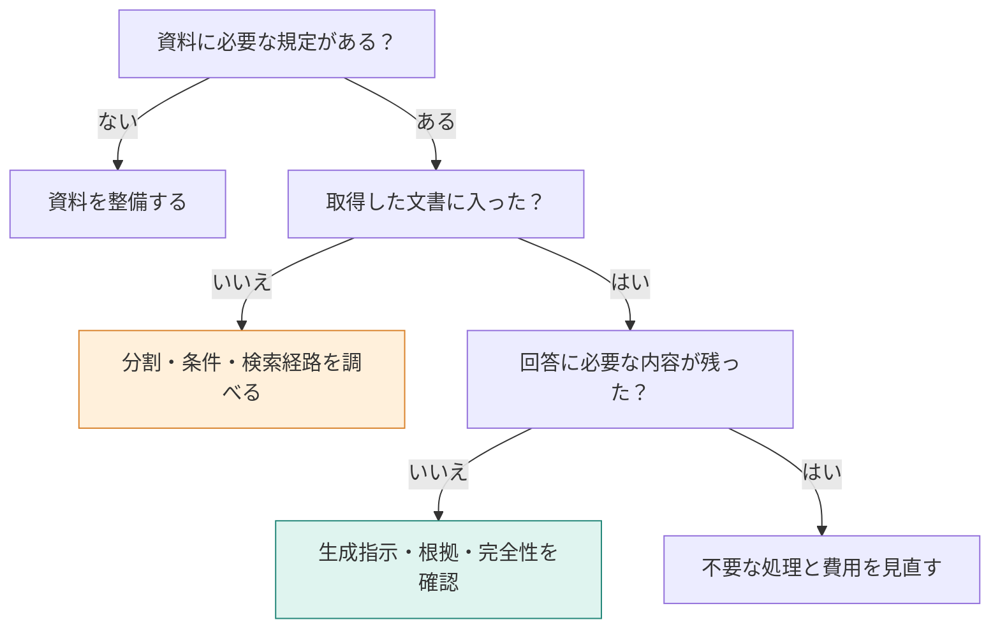

**この章では、新しい手法を足す前に、失敗した場所を特定します。** 資料に規定があるか、取得したか、回答へ残ったかの順に調べます。これまでの結果を使って、次に変える一箇所を選ぶ練習をします。新しい計測結果はありません。

## 同じ「答えられない」でも、直す場所が違う

問い合わせを三つ並べます。どこを最初に調べるでしょう。

| 症状 | 最初に見るもの |
|---|---|
| 有料で90日保存できるか分からない | マニュアルに延長の規定があるか |
| 解約の日割りに、プラン変更の規定だけが出る | 取得した候補に「退会後の請求」があるか |
| 月額の本文があるのに、回答には「満額」としか出ない | 回答が金額まで書いているか |

一つ目は資料の不足、二つ目は取得の不足、三つ目は回答の書き落としです。同じ検索手法を追加しても、すべてを直せるわけではありません。

## STEP 1：資料とチャンクの中身を確認する

まず元の規定を探し、条件と結論が同じチャンクに残っているかを見ます。

- 規定がないなら、検索の工夫では事実を作れません。
- 条件が別の節に落ちているなら、分割や文脈の引き継ぎを直します。
- 本文を更新したなら、DBへ新しい本文とベクトルが入ったかを確認します。

本書の90日延長は、規定そのものがありません。除外で0件にしたり、再検索したりしても、可否は確認できませんでした。

## STEP 2：候補の外か、中かを分ける

| 状態 | 選択肢 | 本書で確認したこと |
|---|---|---|
| 必要な文書が上位k件より下にある | kを増やす、候補内を並べ替える | 第8章は10候補の3位をscore 2.9800で1位へ。k=1・2では回答が変わり、k=3では変わらない |
| 必要な文書が候補に入っていない | 検索文や検索範囲を見直す | 第11章は最初の2件でIncorrect。再検索で「退会後の請求」を足し、満額へ変わる |
| 別カテゴリが混ざる | メタデータ条件を付ける | 第7章は退会カテゴリだけにすると、退会後の請求が1位になる |
| 根拠として弱い候補が多い | 下限を設けて除外する | 第9章は削除の1件を残し、回答の30日後を保った |

Rerankingは候補の外へ探しに行きません。候補に必要な文書がないなら、順位だけ変えても根拠は増えません。

## STEP 3：複数の根拠なら、経路を調べる

| 集め方 | 見る場所 | 本書で残った課題 |
|---|---|---|
| 検索前に戦略を選ぶ | 選んだ戦略と実際の検索結果 | 第10章は複数回を選んでも同じ3件へ戻った |
| 階層を降りる | 最初に外した枝 | 第13章は請求1.2700と退会1.2600で、退会の規定を失った |
| 不足項目を順に探す | 完了条件と蓄積した本文 | 第14章は条件を4情報へ具体化すると、Proと月額の文書まで集められた |
| グラフの関係をたどる | 始点と、必要な関係へのつながり | 第15章は手動SSO始点で月額へ届く。第16章の自動始点では削除の規定へ届かない |

「検索を複数回した」「doneが返った」「グラフを使った」は、必要情報が揃ったことの代わりにはなりません。取得した本文を、質問が求める項目と対応させます。

## STEP 4：根拠の妥当性と、回答の完全性を分ける

第12章の追加実験では、30日の規定に対して固定した90日の誤答を渡すと、矛盾の検出から30日への修正まで動きました。一方、適切な「分からない」にも修正がかかる例がありました。

第14章の `hop-facts` では、SSO対応プラン、月額、満額、30日の4情報を取得しました。それでも回答から12000円が抜けました。

| 確認すること | 見落とすと起こること |
|---|---|
| 書いた主張を本文で裏付けられるか | 文書にない日数や金額を断定する |
| 質問で求められた項目をすべて書いたか | 正しい文だけでも、金額などが抜ける |

回答の根拠だけを評価しても、書いていない金額は拾えない可能性があります。採用時には、この二つを別の確認として用意します。

## 一つの問い合わせを、診断してみる

> SSOが使えるプランを月の途中で退会した場合、当月の請求額とデータ削除までの日数は？

取得済みなのは「退会後の請求」「退会後のデータ削除」「プラン変更時の日割り」の3件です。回答は「満額で、データは30日後に削除されます」でした。

まず、自分で次の変更を一つ選んでから、下を開いてください。

:::details 診断例：回答モデルを変える前に、足りない根拠を集める
必要なのは、SSOがProで使えることと、Proの月額12000円です。どちらも現状の入力にありません。

1. 元のマニュアルにSSOとProの月額があるかを確認する。
2. 不足する2節を追加検索などで集める。
3. 4情報が本文に揃ったかを確認する。
4. 最終回答にPro・12000円・満額・30日があるかを確認する。

第14章では2と3まで進みましたが、4で12000円が抜けました。その状態になったら、次は生成指示や完全性の確認を変えます。検索だけを増やし続ける理由は弱くなります。
:::

## 採用を決める比較は、件数と費用まで残す

単一の成功例では、どの問い合わせにも有効かは分かりません。次の表を、自分の質問セットで埋めると、変更の目的を見失いにくくなります。

| 記録項目 | 確認したいこと |
|---|---|
| 質問・期待する情報・根拠のID | 何を答えられれば成功か |
| 取得したIDと本文 | 検索の取りこぼしか |
| 評価の入力、choiceやscore、実行した分岐 | 判断とコードは意図どおりか |
| 最終回答 | 矛盾や項目の欠落がないか |
| 検索回数、評価と生成それぞれのトークン・時間 | 改善に追加費用が見合うか |

本書では、同じ質問を繰り返した安定性の評価、資料の改名・削除まで含む索引の同期、利用者ごとの閲覧権限は実装していません。問い合わせの種類を増やして評価するときは、これらも次の課題になります。

手法名から選ぶのではなく、足りない一文がどこで失われたかを探す。その場所が分かれば、次に直す処理も具体的になります。

:::details 出典と結果の範囲
各表は本書の第3〜16章で説明した保存ログと、第12章の固定誤答実験を整理したものです。15・16・18節の実験が混在するため、章をまたぐ時間や点数を同条件の比較として扱っていません。複数手法を統合した性能比較も実施していません。
:::
