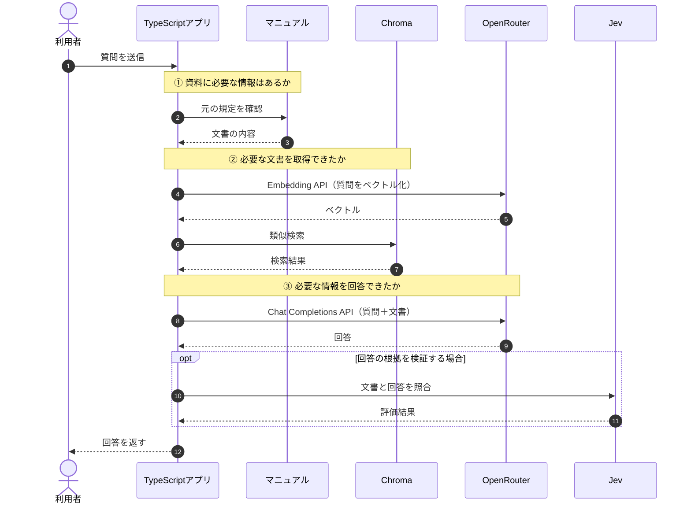

## RAGの使い分けを考える

本書では、Naive RAGからGraph RAGまで、さまざまな検索・回答手法を実装してきました。しかし、複雑なRAGを採用すれば、必ず回答精度が高くなるわけではありません。

重要なのは、**RAGがうまく回答できなかったとき、どの処理に問題があるのかを特定すること**です。

例えば、同じ「正しく回答できない」という現象でも、原因は次のように異なります。

| 問題 | 原因 |
|---|---|
| 有料で90日間保存できるか分からない | マニュアルに規定が存在しない |
| 解約月の日割りを正しく答えられない | 必要な文書を検索できていない |
| Proプランの月額が回答から抜ける | 文書は取得できたが、回答に反映されていない |

この3つは改善すべき場所が異なります。

## ① まず、どこで問題が起きたのかを確認する

RAGは、マニュアルの準備、検索、回答生成という処理に分かれています。まずは、それぞれの段階で必要な情報が存在しているかを確認します。

※ この図は問題の確認箇所を整理したもので、全手法をまとめた新しい実装ではありません。

まず元のマニュアルに規定があるかを確認し、次に検索で取得できているか、最後に回答へ反映されているかを調べます。**この順番を守ることで、改善すべき処理を絞り込めます。**

## ② 課題に応じてRAGを選ぶ

これまで学んだ手法を、解決したい課題から整理します。

| 手法 | 向いている課題 | 注意点 |
|---|---|---|
| Naive RAG | まず検索して回答したい | 検索結果の品質に依存する |
| メタデータフィルタ | 検索対象をカテゴリで絞りたい | 条件を間違えると必要な文書を失う |
| Reranking RAG | 必要な文書の検索順位が低い | 候補にない文書は取得できない |
| Filtering RAG | 回答に不要な文書を除外したい | 必要な文書まで除外する可能性 |
| Adaptive RAG | 質問によって検索方法を変えたい | 戦略の判断が間違う可能性 |
| Corrective RAG | 検索結果が不十分なので取り直したい | 再検索しても改善するとは限らない |
| Self-RAG（簡易実装） | 生成した回答の根拠を確認したい | 評価器も判断を間違える |
| DecisionRAG | 階層化した文書を段階的に探索したい | 途中で正しい階層を除外する可能性 |
| Multi-hop RAG | 複数の文書を組み合わせたい | 完了判断が早すぎる可能性 |
| Graph RAG | 情報同士の関係をたどりたい | 関係や探索開始点の整備が必要 |

これらは排他的な選択肢ではありません。例えば、メタデータで検索対象を絞った後、Rerankingで順位を改善し、生成した回答をJevで検証することもできます。ただし、処理を追加するほどAPI呼び出しや設計上の判断も増えるため、必要な改善から始めます。

## ③ 実験結果から改善方法を選ぶ

### ケースA：必要な規定が検索順位の下にある

> Standardプランを月の途中で解約したら、日割りになりますか？

第8章では、正しい規定「退会後の請求」がChromaの検索3位になりました。上位1〜2件をそのまま使うNaive RAGでは回答できませんでしたが、Jevで再評価すると正しい規定が評価1位になり、回答できました。

この場合は**Reranking RAG**が有効でした。ただし、最初から上位3件を渡した場合はNaive RAGでも回答できているため、Rerankingの追加コストに見合うかも確認する必要があります。

### ケースB：必要な規定が候補に存在しない

同じ質問について、最初の検索結果を2件に制限した第11章では、Jevが`Incorrect`を選択しました。

その後、OpenRouterが検索文を作り直し、Chromaで再検索したことで「退会後の請求」を新しく取得できました。最終回答は「分からない」から「満額・日割りなし」に改善しています。

この場合は**Corrective RAG**が有効でした。Rerankingと違い、候補の外にある文書を探しに行くことがポイントです。

### ケースC：複数の情報が必要

> SSOが使えるプランを月の途中で退会した場合、当月の請求額とデータ削除までの日数は？

第14章のMulti-hop RAGでは、Jevの完了条件を具体化することで、次の4つの情報を取得できました。

| 必要な情報 | 取得結果 |
|---|---|
| SSO対応はProプラン | 取得できた |
| Proの月額は12,000円 | 取得できた |
| 解約月は満額 | 取得できた |
| データ削除は30日後 | 取得できた |

しかし、**最終回答には12,000円が含まれませんでした。**

この場合、追加検索を繰り返すよりも、まず回答生成の指示や必要項目の網羅性を確認すべきです。検索で情報を集められたかと、回答でその情報を使えたかは別の問題です。

### ケースD：検索の途中で正しい情報を失う

第13章のDecisionRAGでは、解約月の日割りについてカテゴリを評価したところ、「請求」が1.2700、「退会」が1.2600でした。

0.01の差で「請求」だけが残り、正しい規定のある「退会」の階層が探索対象から外れました。こうした場合は、Jevのスコアだけでなく、**閾値や上位何件を残すかというアプリ側の設計**も見直す必要があります。

第16章のGraph RAGでも、質問から選んだ開始点がSSOやデータ削除につながらず、必要な文書を取得できませんでした。階層や関係を使う方法では、探索の途中で情報を失っていないかを確認することが重要です。

## ④ 実際に問題を診断してみる

最後に、これまで扱った質問をもう一度考えてみます。

> SSOが使えるプランを月の途中で退会した場合、当月の請求額とデータ削除までの日数は？

現在取得している文書が「退会後の請求」「退会後のデータ削除」「プラン変更時の日割り」の3件で、回答が「満額で、データは30日後に削除されます」だったとします。

この場合、改善の順番は次のようになります。

1. 元のマニュアルにSSO対応プランと月額料金の規定があるか確認する
2. 取得した文書に不足があれば、Multi-hop RAGなどで追加検索する
3. 4つの必要情報が文書に揃ったか確認する
4. 最終回答にPro・12,000円・満額・30日が含まれているか確認する

第14章では、追加検索によって3まで達成できましたが、4で金額が抜けました。この状態で検索だけを増やしても、回答の網羅性が改善するとは限りません。

## ⑤ RAGの改善をどう評価するか？

RAGを改善するときは、単純に「正しい回答が出たか」だけを見るのでは不十分です。どの処理が改善されたのかを分けて記録することで、効果を確認しやすくなります。

| 評価項目 | 確認する内容 |
|---|---|
| 検索の再現率 | 必要な文書を取得できたか |
| 検索の適合性 | 回答に役立つ文書が上位にあるか |
| 回答の根拠 | 文書にない内容を断定していないか |
| 回答の網羅性 | 質問に必要な情報が抜けていないか |
| 処理コスト | APIの呼び出し回数・トークン数・時間 |
| 安定性 | 同じ質問を繰り返しても結果が安定するか |

本書では、各章で保存した実行ログを使って手法を比較しました。ただし、15・16・18チャンクという異なる条件の実験も含まれており、すべての手法を統一条件で比較したわけではありません。

また、同じ質問を何度も実行した安定性の検証や、実サービスでの大量の問い合わせを使った評価も行っていません。今後、実際のサービスに導入する場合は、評価用の質問セットを用意し、改善前後で同じ条件の比較を繰り返す必要があります。

## まとめ

本書では、Naive RAGから始めて、Reranking・Filtering・Adaptive・Corrective・Self-RAG・DecisionRAG・Multi-hop・Graph RAGへと学習を進めてきました。

それぞれ異なる課題を解決する方法ですが、**複雑なRAGが常に優れているわけではありません。** Jevによる判断で回答が改善した実験もあれば、判断によって必要な情報を失った実験もありました。

今回学んだことは、RAGを改善する際には、まず次の3点を区別する必要があるということです。

- **資料の問題：** そもそも必要な情報が存在するか
- **検索の問題：** 必要な情報をLLMへ渡せているか
- **回答生成の問題：** 渡した情報を正しく、漏れなく回答できているか

RAGの手法をたくさん知ること自体がゴールではありません。**課題を特定し、その課題に合った検索・評価・回答の仕組みを選べるようになること**が重要です。

これで、本書のRAG学習シリーズは完了です。

