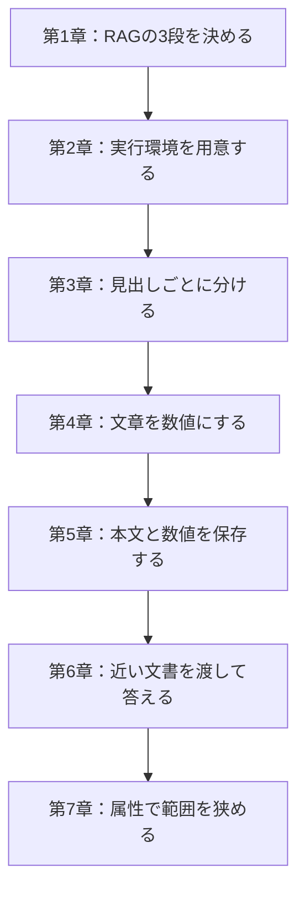

> **この部の要点：** 資料を検索できる形にして、近い文書を渡して答える基本のRAGを一度つなげます。

第1部では、RAGが何かを定義し、マニュアルを探せる形にして、近い文書を渡して答えるところまでを扱います。以後の章で比較するときの基本構成は、ここで作る Naive RAG です。各章の比較実験では、この基本構成をその章と同じ条件で実行します。

## この部で分かること

- 文書を渡すと、LLM単体の答えが変わること
- マニュアル全文を一度に渡すことには、入力の長さ、処理時間、費用の面で限界があること
- RAGが、用意、検索、生成の3段であること
- 見出し、ベクトル、ベクトルDBが、用意の中身であること
- 近い文書を渡しても、必要な規定が上位に入らない質問があること
- 属性が分かっているときは、近い順の前に範囲を狭められること
- 実装の前に、Docker と API キーが揃っていること

## この部の章

| 章 | 役割 |
|---|---|
| [第1章 RAGとは何か](./01-what-is-rag) | 言葉と3段を固定する |
| [第2章 環境構築](./02-setup) | 実装の直前に、Docker と OpenRouter、Jev のキーを用意する |
| [第3章 マニュアルを見出しで分ける](./03-split-by-heading) | 1件を1つの規定にする |
| [第4章 文章をベクトルにする](./04-embedding) | 文章を数値の列にし、意味の近さを比べられるようにする |
| [第5章 ベクトルDBに登録する](./05-vector-db) | 本文、数値、見出し、所属を残す |
| [第6章 近い文書を渡して答える](./06-naive-rag) | Naive RAG。以後の比較相手 |
| [第7章 属性で検索範囲を狭める](./07-metadata-filter) | 分類が分かっているときの検索。第2部の前提にはしない |

図は、実装する場合の順番です。第7章は第6章の基本構成を置き換える章ではありません。

実装する場合は、第2章で環境を用意し、第3〜6章の順で進めます。読むだけなら、各章の要点、図、比較表、まとめから入れます。第7章は、属性で検索範囲を狭める独立した例です。

第2部は、解約月の日割りを聞いたのに「退会後の請求」が漏れた例から始まります。入口は [第8章 検索結果を並べ替える](./08-rerank) です。
