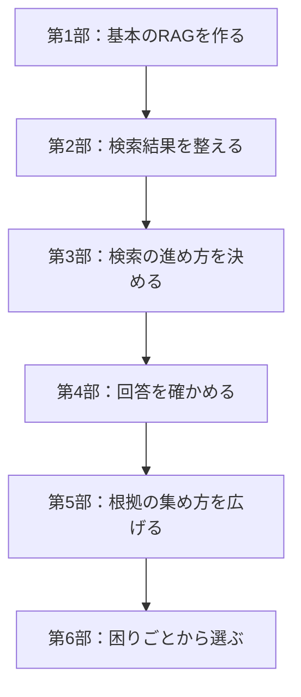

この本は、手元の資料を使って答える RAG を、一つのマニュアルの上で読み比べます。入口は二つあります。全体の流れから読むときは第1部からです。特定の失敗を直したいときは、下の「困りごとから探す」から該当の章へ進みます。

流し読みは、各章の**冒頭の要点 → 図 → 比較表 → まとめ**です。各章に前提知識と質問文を再掲してあるので、前の章を覚えていなくても、その章の結論は追えます。

実装の全文は公開予定の GitHub に置きます。章には、実行の要所、処理の流れ、結果の比較表を載せます。

## 困りごとから探す

| 知りたいこと・困りごと | 読む章 |
|---|---|
| RAGの全体像をつかみたい | [第1章 RAGとは何か](./01-what-is-rag) |
| 基本のRAGを動かしたい | [第2章 環境構築](./02-setup) から第3〜6章 |
| 似た別の規定が出てくる | [第7章 属性で検索範囲を狭める](./07-metadata-filter)、[第8章 検索結果を並べ替える](./08-rerank) |
| 不要な文書まで回答に渡している | [第9章 回答に使わない文書を外す](./09-exclude) |
| 検索しなくても答えられそう | [第10章 質問に応じて検索方法を選ぶ](./10-choose-search) |
| 検索結果に必要な根拠がない | [第11章 検索の失敗を検知して取り直す](./11-retry) |
| 回答が、文書にないことを断定する | [第12章 回答が文書に基づいているか確認する](./12-verify-answer) |
| 分類、複数の文書、文書の関係から探したい | [第13章](./13-hierarchy)、[第14章](./14-multi-hop)、[第15章](./15-relations) |
| グラフを使う効果を、同じ条件で見たい | [第16章 ベクトル検索とグラフ検索を比べる](./16-compare) |
| 全体を一枚で振り返りたい | [第17章 困りごとから改善方法を選ぶ](./17-choose) |

## 本の全体像

図は読む順番です。第8章以降の各手法は、第6章の基本のRAGと、その章の中で同時に比べます。前の章の手法の上に、次の手法を積み重ねる実行順ではありません。

## 部

| | 章 | この部で見ること |
|---|---|---|
| | [はじめに](./introduction) | 読者、読み方、題材、繰り返し使う質問、結果の読み方 |
| 第1部 | [RAGの土台](./part1) | RAGとは何かから、文書を登録して答えるところまで |
| 第2部 | [検索結果を整える](./part2) | 取れた文書の順位と、回答に渡す文書 |
| 第3部 | [検索の進め方を決める](./part3) | 検索するか、根拠が足りなければ取り直すか |
| 第4部 | [回答を確かめる](./part4) | 生成した文が、渡した文書に基づくか |
| 第5部 | [根拠の集め方を広げる](./part5) | 階層、複数の文書、文書どうしの関係 |
| 第6部 | [種類の見取り図](./part6) | どの失敗に、どの改善を足すか |

## 章

| 章 | タイトル | この章で見ること |
|---|---|---|
| 1 | [RAGとは何か](./01-what-is-rag) | 資料を探してから答える、という一連の流れ |
| 2 | [環境構築](./02-setup) | 実装の直前に、Docker、OpenRouter、Jev を用意する |
| 3 | [マニュアルを見出しで分ける](./03-split-by-heading) | 長いマニュアルを、検索できる規定の単位にする |
| 4 | [文章をベクトルにする](./04-embedding) | 文章を数値の列にして、意味の近さを比べる |
| 5 | [ベクトルDBに登録する](./05-vector-db) | 本文、ベクトル、見出しなどの属性を保存する |
| 6 | [近い文書を渡して答える](./06-naive-rag) | 基本のRAG。第8章以降の比較相手になる |
| 7 | [属性で検索範囲を狭める](./07-metadata-filter) | 分類が分かっているとき、近い順の前に範囲を狭める |
| 8 | [検索結果を並べ替える](./08-rerank) | 近い順の候補を、質問への有用さで並べ直す |
| 9 | [回答に使わない文書を外す](./09-exclude) | 回答の材料にしない文書を、渡す前に外す |
| 10 | [質問に応じて検索方法を選ぶ](./10-choose-search) | 検索しない、一度探す、など質問に応じて進み方を選ぶ |
| 11 | [検索の失敗を検知して取り直す](./11-retry) | 取れた文書が質問に足りなければ、検索し直す |
| 12 | [回答が文書に基づいているか確認する](./12-verify-answer) | 生成した文が、渡した文書に書いてあるかを確認する |
| 13 | [文書の階層をたどる](./13-hierarchy) | 分類の階層を下りながら、見る文書を絞る |
| 14 | [複数の文書を順に集める](./14-multi-hop) | 一つの文書では足りない質問に、根拠を順に足す |
| 15 | [文書の関係をたどる](./15-relations) | 文書どうしの関係をたどって根拠を探す |
| 16 | [ベクトル検索とグラフ検索を比べる](./16-compare) | 近い文書を渡す方式と、関係をたどる方式を同じ質問で比べる |
| 17 | [困りごとから改善方法を選ぶ](./17-choose) | 各章の結果を、失敗の種類から引ける一枚にする |

第8章以降の比較相手は、第6章で説明する基本のRAGです。表に載せる数値は、その章の中で条件をそろえて同時に実行した組を使います。元になった記事では、途中でマニュアルが12件から15件へ増えています。記事をまたいだ数値を、一つの性能表には混ぜません。第7章の属性絞り込みは、この比較の系列には入れず、独立した例として読みます。
